# Form — 운동 기록

iPhone·iPad와 Android에서 운동을 기록하는 네이티브 앱입니다. 루틴·세트 기록, 3D 운동 자세, 인바디, Apple 건강·Health Connect, Apple Watch·Wear OS 동반 앱을 제공합니다.

**현재 버전은 Form 0.3.5 네이티브 테스트 빌드입니다.** Android 휴대폰과 Wear OS는 테스트 APK, iPhone·iPad와 Apple Watch는 서명이 필요한 IPA로 제공됩니다. 저장소가 공개되어 있어 GitHub 로그인 없이 내려받을 수 있고, 기기에서 건강 연동과 워치 페어링을 검증하는 절차는 설치 문서에 있습니다. [v0.3.5 다운로드](https://github.com/M0lli2/form-fitness/releases/tag/v0.3.5) · [설치 및 실기기 검증](docs/INSTALL.md)

## 0.3.5 변경사항

- 운동 중에도 종목 순서를 위·아래로 바꾸고, 같은 부위의 다른 종목으로 바로 **대체**할 수 있습니다. 두 종목을 **슈퍼세트**로 묶으면 같은 묶음 안에서 번갈아 진행합니다.
- 각 세트 옆·아래에 직전 세션의 같은 순번 기록(`이전 60 kg × 10`)을 표시합니다. 전체 운동 목록과 집중 운동 모두 같습니다.
- **기록 → 종목 성장 그래프**에서 종목을 골라 최근 세션의 추정 1RM과 볼륨을 꺾은선으로 봅니다. 이전 최고를 넘긴 세션과 종목에는 **PR** 배지가 붙습니다.
- 근력 세트에 선택 항목으로 **RPE(1~10, 소수)**를 기록합니다. 예전 기록·백업과 호환됩니다.
- **원판 계산기**가 목표 중량을 바 20kg + 양쪽 원판(25·20·15·10·5·2.5·1.25kg) 조합으로 보여 주고, 정확히 맞출 수 없으면 차이를 알려 줍니다.
- 기본 종목을 63종에서 **118종**으로 늘렸습니다(머신·케이블·덤벨·바벨 변형). 기존 3D 자세·근육 매핑은 그대로입니다.
- 집중 운동 하단은 `세트 완료`와 휴식 타이머 중심으로 간결해지고, 훈련 목적·휴식 상세는 **세부 설정** 안으로 접혔습니다. 중량은 ±2.5kg(±5lb), 횟수는 ±1로 한 손에 조절합니다.
- 집중 운동의 세트 줄을 누르면 완료 세트를 고치거나 다음 세트로 옮겨 갈 수 있고, 일반·워밍업·드롭 전환, 세트 삭제, 운동 메모도 그 화면에서 됩니다.
- 운동도감에 **최근 한 운동 · 즐겨찾기(☆) · 기구별** 필터를 추가했습니다.
- 인바디·체성분은 막대 대신 **꺾은선 추이**로 보여 주고, 홈과 기록 탭에서 바로 들어갑니다.
- 하단 탭 아이콘을 직관적인 심볼로 바꾸고, 운동을 마치면 **최근 운동 요약** 카드에서 직전 대비 볼륨·PR·주간 목표 진행을 보여 줍니다.

### 0.3.5 변경 화면

0.3.5 릴리스 APK를 Android 에뮬레이터에서 실행한 자동 여정이 캡처했습니다. 시험 기록이 맨몸 푸시업(중량 0 kg)이라 볼륨은 0 kg로 표시됩니다.

| 집중 운동 · 경량 컨트롤 | 집중 운동 · 컨트롤 접힘 |
|---|---|
| 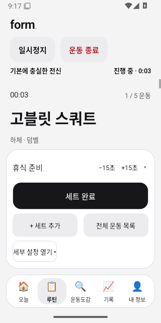 | 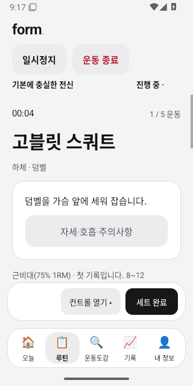 |

| 준비 화면 · 세트 옵션과 RPE | 운동도감 · 최근/즐겨찾기 필터 |
|---|---|
| 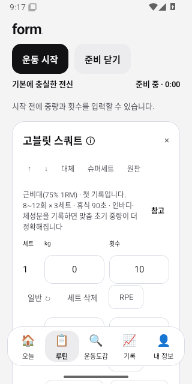 | 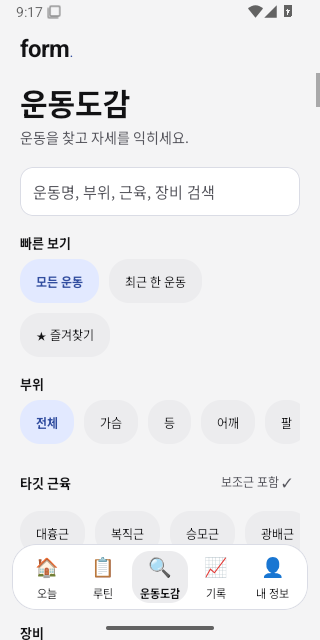 |

| 집중 운동 · 다음 세트 | 기록 · 최근 운동 요약 |
|---|---|
| 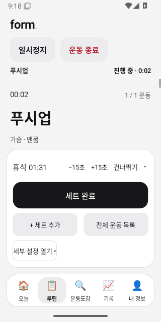 | 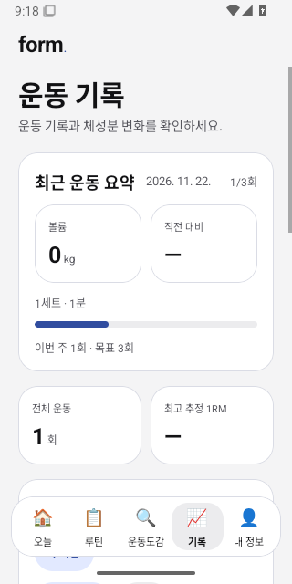 |

## 0.3.4 변경사항

- 루틴·추천 구성으로 들어가면 타이머가 바로 돌지 않고 `준비 중 · 0:00`에서 멈춥니다. 무게와 횟수를 확인·수정한 뒤 상단 **운동 시작**을 눌러야 운동 시간이 흐릅니다. 홈 추천 카드, 루틴 카드의 ▶, 기록의 '같은 구성으로 다시 운동'이 모두 같은 방식입니다.
- 준비 화면에서 어느 세트를 고치든 그 뒤의 미완료·미수정 세트가 같은 값으로 따라옵니다. 2세트에 22 kg을 넣으면 3·4세트도 22 kg이 되고, 시간·거리·RPE도 함께 이어집니다. 직접 고친 세트와 이미 완료한 세트는 덮어쓰지 않습니다.
- 숫자 입력은 다른 칸을 누르거나 키보드를 내리거나 입력을 잠깐 멈춰도 값이 그대로 저장됩니다.
- 집중 운동 하단 컨트롤 박스를 **컨트롤 숨기기 / 컨트롤 열기**로 접고 펼 수 있습니다. 접으면 큰 박스 대신 `컨트롤 열기`와 작은 `세트 완료`만 남아 뒤쪽 추천 문구와 안내를 가리지 않습니다.
- 루틴마다 **추천 포함 ON/OFF**를 고를 수 있습니다. 홈의 추천 카드와 운동 시작 시트에는 추천에 포함한 루틴만 나오고, 모두 제외하면 자유 운동으로 안내합니다.
- 기본으로 들어 있는 추천 구성도 이름·설명·운동 종목·추천 여부를 직접 고치거나 삭제할 수 있습니다. 내 루틴 이름도 직접 쓰고, 운동을 넣었다 빼며, 추천에 넣을지 정할 수 있습니다. 삭제는 확인을 거치며 운동 기록은 남습니다.

### 0.3.4 변경 화면

0.3.4 릴리스 APK를 Android 에뮬레이터에서 실행해 자동 여정이 캡처했습니다. 루틴으로 들어가 `준비 중 · 0:00`에서 멈춘 화면, 1세트에 넣은 22 kg이 2세트로 이어진 모습, 집중 운동 컨트롤을 접었을 때와 펼쳤을 때입니다.

| 루틴 준비 · 타이머 0:00 | 세트 값 자동 반영 |
|---|---|
| 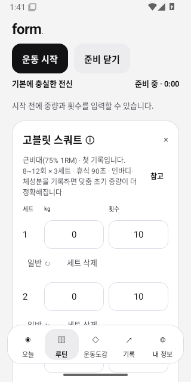 | 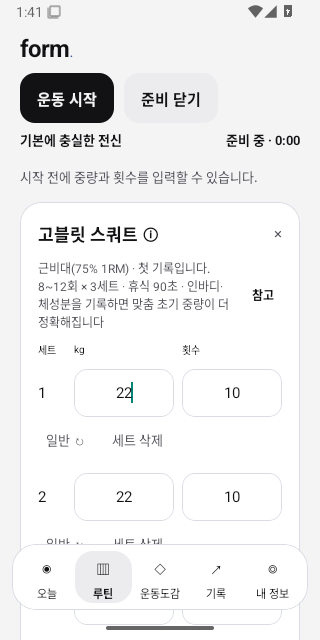 |

| 집중 운동 · 컨트롤 접힘 | 집중 운동 · 컨트롤 펼침 |
|---|---|
| 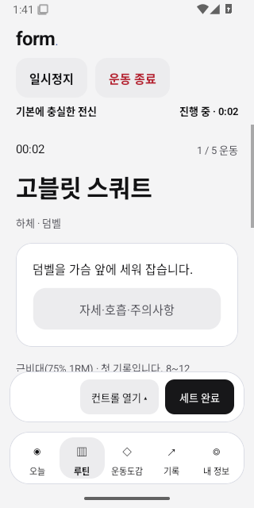 | 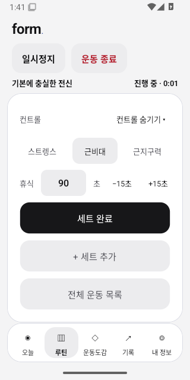 |

| 기본 루틴 편집 · 추천 포함 | 추천 포함을 끈 상태 |
|---|---|
| 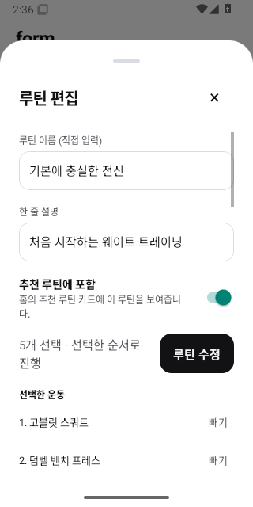 | 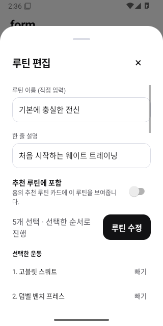 |

## 0.3.3 변경사항

- 근육 모델을 GPU로 그립니다. iOS는 Metal, Android는 OpenGL ES 3로 기기 배율 전체 해상도에 4x MSAA를 더해 실루엣이 매끈하고, 운동 중 표면 갱신도 부드럽습니다. GPU를 쓸 수 없는 기기에서는 기존 소프트웨어 렌더러로 물러납니다.
- 주간 근육 볼륨에서 "이번 주 완료한 세트가 아직 없습니다" 안내가 모델 발목과 겹치지 않도록 인체 모형 아래로 옮겼습니다.
- iOS 26 Glass·Tinted 홈 화면 테마에서 앱 아이콘의 F가 빈 외곽선이 아니라 꽉 찬 밝은 글자로 보입니다.
- 1세트의 중량·횟수를 입력하면 아직 손대지 않은 2·3세트가 같은 값으로 따라오고, 세트를 추가하면 직전 세트의 값이 이어집니다. 직접 고친 세트는 덮어쓰지 않습니다.
- 훈련 목적(스트렝스 85% · 근비대 75% · 근지구력 60% 1RM)을 고르면 추정 1RM과 목적 비율로 무게·반복·세트를 추천합니다. 이전 기록이 없으면 최신 체성분(체중·골격근량·체지방률)으로 시작 무게를 추정하고, 그 근거를 화면에 표시합니다.
- 휴식 시간은 목적과 장비에 맞춰 추천되며(스트렝스 바벨 180초, 근비대 90~120초, 근지구력 60초), 운동 중에 ±15초·60/90/120초·직접 입력으로 바꿀 수 있습니다.
- 인바디 스크린샷을 고르면 기기 안에서 글자를 읽어 키·체중·골격근량·체지방을 채웁니다(iOS Vision, Android는 붙여넣기). 키는 최근 기록에서 자동으로 채워집니다.
- 체성분 변화는 측정한 날짜 순서대로 체중·골격근량·체지방률을 그래프로 보여 주고, 직전 측정과 첫 측정 대비 변화량을 함께 표시합니다.
- 집중 운동 화면의 하단 조작 상자가 떠 있는 탭 바와 겹치지 않고, 상자 뒤로 여백이 남지 않습니다.

| 고화질 근육 모델 (iOS 3x) | 근육 볼륨 · 문구 분리 |
|---|---|
| 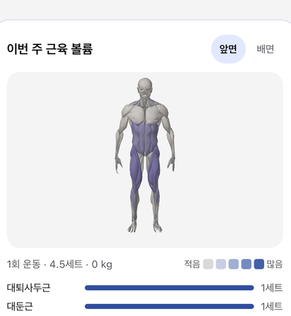 | 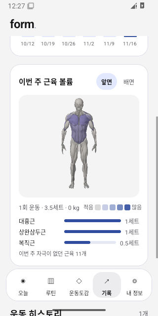 |

| 집중 운동 · 하단 상자 분리 | 훈련 목적 설정 |
|---|---|
| 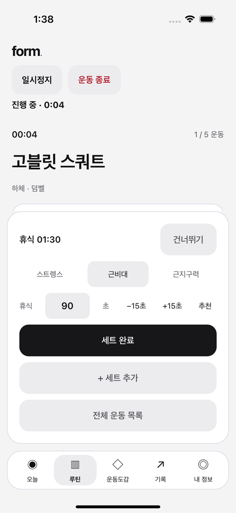 | 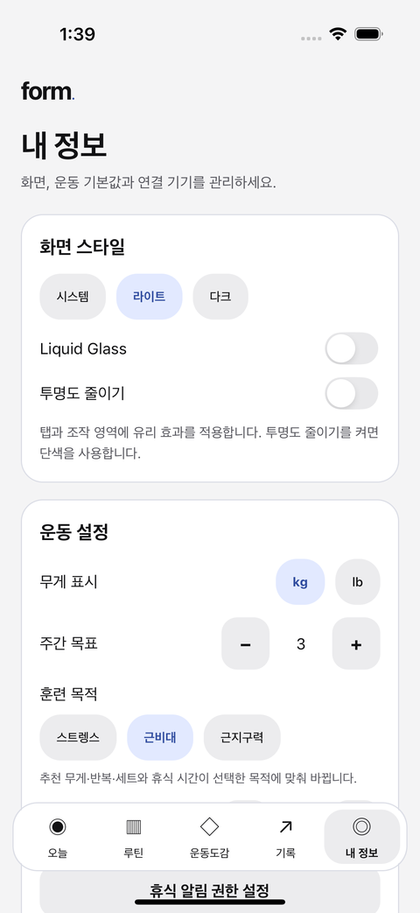 |

## 0.3.2 변경사항

- 운동도감의 기본 63종과 사용자 추가 운동에서 같은 3D 모델로 근육을 확인할 수 있습니다. 22종은 기존 자세 재생을 지원하고, 나머지는 대상 근육과 단계별 운동 방법을 제공합니다. 동작을 재생하면 근육 표면이 자세를 따라 움직입니다.
- 운동도감의 근육 선택과 기록의 최근 7일 근육 볼륨에도 동일한 조형을 사용합니다. 몸통과 팔다리를 16개 근육 부위로 나누고, 무광 회백색을 기본으로 쓰며 주동근·보조근과 선택한 근육, 기록된 볼륨을 보라색으로 표시합니다.
- 루틴에서 운동 종목을 추가한 뒤 시작 전에 중량·횟수를 입력하고 세트를 추가할 수 있습니다.
- 같은 빌드에서 Android·Wear OS APK 2종과 iPhone·iPad·Apple Watch용 무서명 IPA 2종, SHA-256 체크섬을 함께 올렸습니다.

| 시작 전 세트 입력 | 3D 근육 모델 |
|---|---|
| 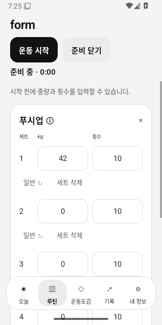 | 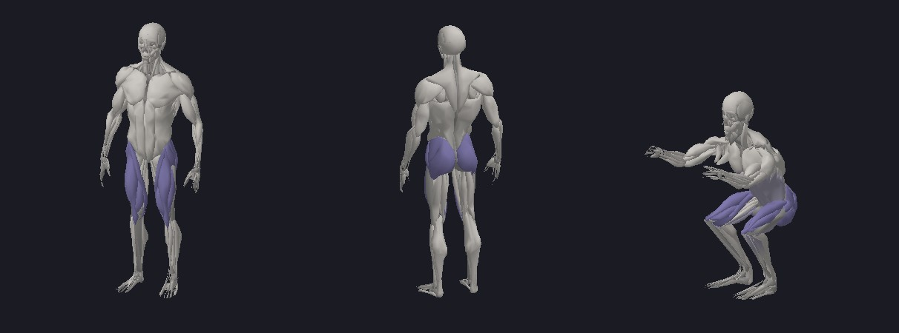 |

[3D 근육 및 자세 가이드](docs/MOTION-GUIDE.md) · [원본 조형 출처와 변환](docs/anatomy-sculpt-source.md) · [네이티브 검증 기록](https://github.com/M0lli2/form-fitness/actions/workflows/form-test-release.yml)

## 버전별 변경사항

| 버전 | 배포·변경 내용 |
|---|---|
| **0.3.5** | 운동 중 순서 변경·대체 운동·슈퍼세트, 세트별 직전 기록, 종목 성장 그래프와 PR 배지, 선택형 RPE, 원판 계산기, 기본 118종, 집중 운동 경량 컨트롤·빠른 조절·세트 목록 터치, 도감 최근/즐겨찾기/기구 필터, 체성분 꺾은선, 직관적 탭 아이콘과 운동 완료 요약을 반영했습니다. [릴리스](https://github.com/M0lli2/form-fitness/releases/tag/v0.3.5) |
| 0.3.4 | 루틴·추천 구성 진입을 `준비 중 · 0:00`으로 통일하고 세트 값 자동 반영을 2세트 이후까지 확장했습니다. 집중 운동 하단 컨트롤 접기/펼치기, 루틴 추천 포함 ON/OFF와 기본 루틴 수정·삭제를 추가했습니다. [릴리스](https://github.com/M0lli2/form-fitness/releases/tag/v0.3.4) |
| 0.3.3 | 근육 모델을 Metal·OpenGL ES 3 기반 3x MSAA 고화질로 교체했습니다. iOS 26 Glass·Tinted 아이콘을 채운 F로 보정하고, 주간 근육 볼륨 안내 문구 겹침과 집중 운동 하단 겹침을 고쳤습니다. 세트 값 자동 반영·추가 세트 복사, 훈련 목적 기반 추천 무게·반복·세트·휴식, 운동 중 휴식 시간 자유 설정, 인바디 스크린샷 인식(iOS)과 체성분 추이 그래프를 추가했습니다. [릴리스](https://github.com/M0lli2/form-fitness/releases/tag/v0.3.3) |
| 0.3.2 | 원본 조형을 바탕으로 한 3D 근육 모델을 운동도감 전체, 자세 가이드 22종과 최근 7일 근육 볼륨에 적용했습니다. 운동을 시작하기 전 중량·횟수 입력과 세트 추가가 가능합니다. [릴리스](https://github.com/M0lli2/form-fitness/releases/tag/v0.3.2) |
| 0.3.1 | 기본 홈 화면 아이콘을 흰 배경과 굵은 검은색 대문자 F로 변경했습니다. Android 적응형·테마 아이콘과 iOS·iPadOS·watchOS용 Liquid Glass 레이어를 적용했습니다. [릴리스](https://github.com/M0lli2/form-fitness/releases/tag/v0.3.1) |
| 0.3.0 | Android·iOS와 두 워치 빌드 번호 3. 빈 운동 준비와 수동 시작, 주간·일간 운동 볼륨, 하단 탭 바깥 배경 제거, 주간 목표·휴식 시간 버튼 정렬을 반영했습니다. iOS 건강 연동과 워치 연결 상태 전달을 보강했고, Apple Watch의 시간제 세트 및 심박 대기 표시를 개선했습니다. [변경 커밋](https://github.com/M0lli2/form-fitness/compare/v0.2.0...v0.3.0) · [릴리스](https://github.com/M0lli2/form-fitness/releases/tag/v0.3.0) |
| 0.2.0 | 앱 표시 이름 **Form**, Android·iOS 빌드 번호 2. 근육 기능을 포함하며 일시정지→계속하기→저장 종료를 검증 경로에 추가했습니다. 휴대폰 APK와 서명이 같은 **Wear OS APK**를 함께 배포합니다. [v0.2.0 릴리스](https://github.com/M0lli2/form-fitness/releases/tag/v0.2.0) |
| 0.1.0 피드백 프리뷰 | 3D 자세 22종, 근육 해부 그래픽과 터치, 주간 근육 볼륨, 운동도감 근육 필터. [Android 프리뷰](https://github.com/M0lli2/form-fitness/releases/tag/preview-2026-11-19-feedback) |
| 0.1.0 초기 프리뷰 | 운동 기록, 3D 자세 8종, 라이트·다크와 Liquid Glass. [초기 프리뷰](https://github.com/M0lli2/form-fitness/releases/tag/preview-2026-11-19) |


0.3.3부터 Glass·Tinted 테마에서도 F가 꽉 찬 밝은 글자로 보이도록 아이콘 레이어의 유리 효과와 반투명을 끄고 Tinted 전용 색을 넣었습니다. 0.3.1은 흰 배경과 검은색 **Segoe UI Bold F**를 기본으로 사용합니다. Apple의 어두운 아이콘 모드에서는 대비를 위해 밝은 F를 사용하며, Liquid Glass 효과는 운영체제가 렌더링합니다. [Apple 아이콘 형식](https://developer.apple.com/design/human-interface-guidelines/app-icons)

## 기능 사용법

| 기능 | 사용 방법 |
|---|---|
| 운동 시작·일시정지·종료 | 루틴 탭에서 **빈 운동 시작**을 누르면 운동을 미리 고를 수 있는 준비 화면이 열립니다. **루틴 카드의 ▶나 홈의 추천 루틴으로 들어가도 같은 준비 화면**에서 `0:00`으로 멈춰 있고, 세트·중량·횟수를 확인한 뒤 **운동 시작**을 눌러야 타이머가 흐릅니다. 일시정지하면 운동 시간과 휴식 타이머가 멈춥니다. 계속하기로 기록을 이어가고 운동 종료에서 완료한 세트를 저장합니다. |
| 순서 변경·대체·슈퍼세트 | 운동 중 종목 카드의 **↑ / ↓**로 순서를 바꾸고, **대체**에서 같은 부위의 다른 종목을 고릅니다. **슈퍼세트**를 누르면 앞 종목과 묶이고, 집중 운동은 같은 묶음의 종목을 번갈아 안내합니다. |
| 세트별 이전 기록·RPE | 각 세트 아래 `이전 60 kg × 10`처럼 지난 세션의 같은 순번 기록이 보입니다. 근력 세트의 **RPE** 칸에 1~10(예: 8.5)을 선택적으로 남깁니다. |
| 종목 성장·PR | **기록 → 종목 성장 그래프**에서 종목을 고르고 **추정 1RM / 볼륨**을 전환합니다. 이전 최고를 넘긴 세션에는 **PR** 배지가 붙습니다. |
| 원판 계산기 | 운동 중 **원판** 버튼에서 목표 중량을 넣으면 바 20kg과 양쪽 원판 조합, 실제 적재 무게를 보여 줍니다. |
| 집중 운동 조작 | 중량 **− / +**는 kg 2.5( lb 5), 횟수는 1씩 조절합니다. 아래 세트 줄을 누르면 완료 세트를 고치거나 다음 세트로 이동하고, **세부 설정**에서 훈련 목적·휴식 상세를 바꿉니다. |
| 운동도감 빠른 보기 | **전체 / 최근 한 운동 / 즐겨찾기**와 기구 필터를 조합합니다. 각 운동의 **☆**를 누르면 즐겨찾기에 남습니다. |
| 체성분 추이 | 홈 또는 기록의 **추이 보기 ›**에서 체중·골격근량·체지방률을 꺾은선으로 확인합니다. |
| 루틴 만들기·고치기·지우기 | 루틴 탭의 **+ 새 루틴**에서 이름을 직접 쓰고 운동을 골라 담습니다. 기본으로 들어 있는 추천 구성도 **루틴 편집**에서 이름·설명·운동·**추천 포함** 여부를 바꾸고 **삭제**할 수 있습니다. 카드의 **추천 포함/제외** 스위치로 홈 추천 카드 노출을 바로 바꿉니다. |
| 주간·일간 운동 볼륨 | 홈의 **이번 주 운동**에서 **주간**을 누르면 월요일부터 일요일까지의 합계를 봅니다. 요일을 누르면 **일간**으로 전환되어 그날의 운동 횟수와 볼륨을 봅니다. |
| 주간 목표·휴식 시간 | **내 정보 → 운동 설정**에서 각 항목의 **− / +**로 값을 조절합니다. 숫자의 자릿수가 달라도 두 줄의 버튼은 같은 위치에 표시되며, 최소·최대값에서는 해당 방향의 버튼이 비활성화됩니다. |
| 3D 자세·근육 정보 | 운동도감의 모든 운동에서 근육을 확인합니다. 3D 자세 표시가 있는 22종은 재생과 8방향 회전을 지원합니다. 모델의 근육 또는 범례를 누르면 상세 정보를 확인할 수 있습니다. |
| 주간 근육 볼륨 | 기록 화면의 **이번 주 근육 볼륨**에서 최근 7일간 완료한 세트가 어느 근육에 분포했는지 앞면·배면으로 봅니다. |
| 근육별 운동 검색 | 운동도감의 **타깃 근육**에서 세부 근육을 선택합니다. 보조근 포함 스위치와 장비 필터를 함께 사용할 수 있습니다. |
| 인바디·건강·워치 | 기록에서 체성분과 결과지 사진을 저장합니다. 내 정보에서 건강 앱 연결과 워치 연결 상태를 확인합니다. |

### 0.3.0 변경 화면

0.3.0 릴리스용 APK를 Android 에뮬레이터에서 실행해 캡처했습니다. 빈 운동이 `0:00`에서 대기하는 상태, 일시정지 후 조작 버튼, 주간·일간 전환, 하단 탭 외곽과 설정 버튼 정렬을 확인할 수 있습니다. [Android 실행·검증 기록](https://github.com/M0lli2/form-fitness/actions/runs/44655494908)

| 빈 운동 준비 · 타이머 0:00 | 일시정지 · 계속하기 · 운동 종료 |
|---|---|
| 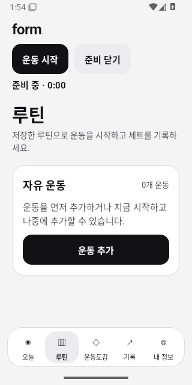 | 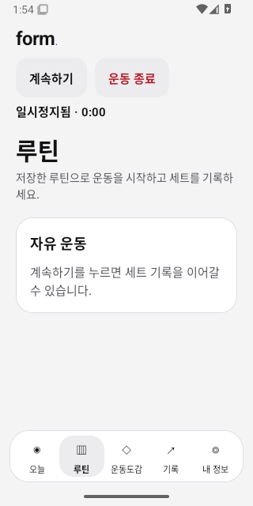 |

| 주간 운동 볼륨과 하단 탭 | 요일 선택 후 일간 운동 볼륨 |
|---|---|
| 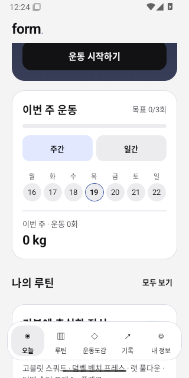 | 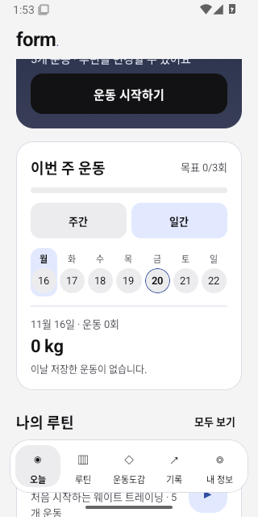 |

| 운동 설정 · 주간 목표와 휴식 시간 |
|---|
| 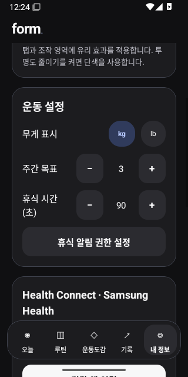 |

### 0.3.2 3D 근육 화면

0.3.2 릴리스 APK를 Android 에뮬레이터에서 실행해 캡처했습니다. 운동도감과 자세 가이드, 최근 7일 근육 볼륨이 같은 조형과 색을 사용하는 것을 확인할 수 있습니다. [Android 실행·검증 기록](https://github.com/M0lli2/form-fitness/actions/runs/44898733252)

| 3D 자세 가이드 · 푸시업 | 최근 7일 근육 볼륨 · 앞면 | 최근 7일 근육 볼륨 · 배면 |
|---|---|---|
| 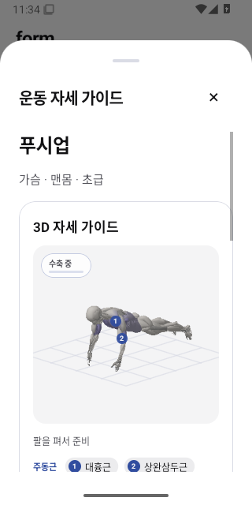 | 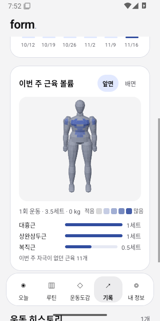 | 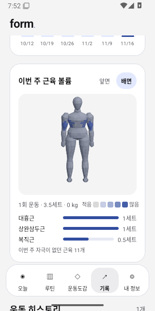 |

## 설치

| 환경 | 파일 및 설치 방법 |
|---|---|
| Android 휴대폰 | [Form-0.3.5-Android.apk](https://github.com/M0lli2/form-fitness/releases/download/v0.3.5/Form-0.3.5-Android.apk). 기존 Form 테스트 APK와 같은 인증서로 업데이트할 수 있습니다. |
| Wear OS · Galaxy Watch4 이후 | [Form-0.3.5-Wear-OS.apk](https://github.com/M0lli2/form-fitness/releases/download/v0.3.5/Form-0.3.5-Wear-OS.apk). 휴대폰 APK와 같은 테스트 인증서를 사용합니다. |
| iPhone · iPad | [Form-0.3.5-iOS-unsigned.ipa](https://github.com/M0lli2/form-fitness/releases/download/v0.3.5/Form-0.3.5-iOS-unsigned.ipa). 설치 전에 Apple 서명과 프로비저닝이 필요합니다. |
| iPhone + Apple Watch | [Form-0.3.5-iOS-unsigned-watch.ipa](https://github.com/M0lli2/form-fitness/releases/download/v0.3.5/Form-0.3.5-iOS-unsigned-watch.ipa). 휴대폰·워치 앱 각각에 올바른 서명과 권한 구성이 필요합니다. |

[SHA-256 체크섬](https://github.com/M0lli2/form-fitness/releases/download/v0.3.5/Form-0.3.5-SHA256SUMS.txt) · [설치 순서 및 TestFlight 준비](docs/INSTALL.md)

네 파일 모두 공개 저장소의 릴리스에 올라 있어 GitHub 계정 없이 내려받을 수 있습니다. iPhone·iPad와 Apple Watch 파일은 미서명이므로 설치하려면 Apple 서명과 프로비저닝이 필요합니다.

## 이전 테스트 빌드 실행 화면

GitHub Actions의 Android 에뮬레이터와 iPhone 시뮬레이터에서 캡처한 화면입니다. 운동 히스토리에는 자동 테스트가 저장한 푸시업 기록이 표시됩니다.

| iPhone 홈 | Android 홈 | 운동 중 휴식 및 세트 완료 |
| :---: | :---: | :---: |
|  |  | 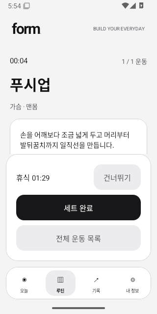 |

| 다크 모드 · Glass 켜짐 | 재실행 후 운동 기록 |
| :---: | :---: |
| 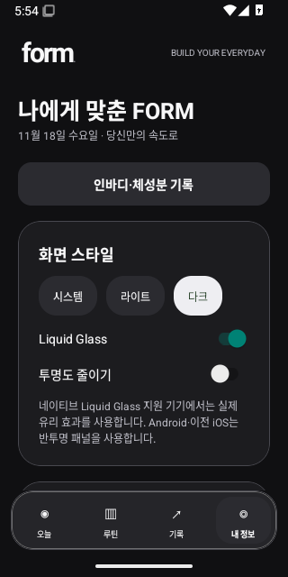 | 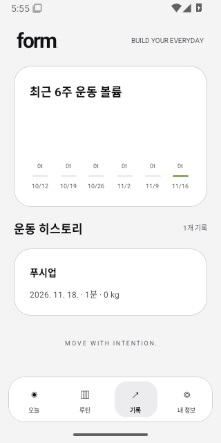 |

Android 캡처는 [저장·복원 테스트](https://github.com/M0lli2/form-fitness/actions/runs/44246921105), iPhone 홈 캡처는 [iOS 실행 검증](https://github.com/M0lli2/form-fitness/actions/runs/44245272504)에서 확인할 수 있습니다.

## 운동도감과 3D 자세

- 하단 **운동도감**에서 운동을 선택하면 자세 상세가 열립니다. 운동 중 **운동 추가**에서도 자세를 확인한 뒤 추가할 수 있습니다.
- 3D 가이드는 푸시업·맨몸 스쿼트·덤벨 컬 등을 포함해 총 22종입니다. 대상 운동에는 운동도감에서 3D 표시가 나타납니다.
- 모델은 원본 조형의 표면을 저장된 관절 좌표에 맞춰 변형합니다. 재생·일시 정지, 방향 전환, 확대, 주요 자세 전환을 지원합니다. 다른 운동도 단계별 텍스트 가이드를 제공합니다.
- **근육 해부 모델**은 몸통과 팔다리의 입체 표면 위에 16개 근육 부위의 윤곽을 표시합니다. 모델이나 범례를 탭해 근육을 선택할 수 있습니다. [자세 가이드 모델](docs/MOTION-GUIDE.md)
- 근육 그래픽과 회전 조작은 [0.3.2 3D 근육 화면](#032-3d-근육-화면)에서 확인할 수 있습니다.

## 디자인 검토

- 라이트 / 다크 / 시스템 설정 추종.
- **Liquid Glass ON/OFF 독립 설정**. 기본 OFF.
- OFF: 단색 패널. ON: 지원 iOS에서 네이티브 GlassView, 다른 환경에서 반투명 패널.
- 투명도 줄이기, 44~48pt 이상 주요 터치 영역, 명시적인 저장 오류, 빈 상태.
- `design/preview.html`: 홈·운동·인바디 비교용 인터랙티브 시안. 네이티브 앱 실행 화면이 아니며 샘플 수치를 사용합니다.
- `design/review-01.png`: 첫 번째 시안. 최신 수정 요청 전 버전으로 이력을 보존합니다.

## 구현한 소스 범위

| 영역 | 포함 내용 | 한계 / 후속 작업 |
|---|---|---|
| 운동 기록 | 세트, 중량, 횟수, 시간, 거리, 일반·워밍업·드롭, 메모, 이전 기록 채움 | 고급 슈퍼세트·RPE 전용 입력 개선 필요 |
| 휴식 | 종료 시각 기준 타이머, 로컬 알림, 취소 | OS 강제 종료·절전 모드 실기기 확인 필요 |
| 루틴 | 생성·편집·삭제, 운동 선택, 이름 직접 입력, 추천 포함 ON/OFF, 기본 전신·상체·하체·맨몸 루틴, 준비 화면 진입 | 주간 캘린더 예약·순서 드래그 미구현 |
| 성장 | 히스토리, 주간·일간 운동 볼륨, 7일 근육 볼륨, 추정 1RM | 소셜 기능 미구현 |
| 운동법 | 한국어 기본 63종, 사용자 운동 등록, 부위·장비 검색, 3단계 설명, 주의사항 | 모든 운동을 망라하지 않음. 3D 관절 가이드 22종. 나머지 3D·동작 영상·트레이너 감수는 후속 |
| 인바디 | 측정일, 체중, 체지방률, 골격근량, 키, 허리둘레, 내장지방 레벨, BMR, 메모, 사진 | 수동 입력. 제조사 API / OCR 미구현 |
| Apple 건강 | 걸음·심박·체중·체지방·최근 운동 읽기, 체중·체지방·운동 쓰기 | 실기기 검증 전. 피트니스 링 반영은 Apple 정책에 따름 |
| Android 건강 | Health Connect 읽기·쓰기, 권한 안내 Activity | Samsung Health에서 공유 설정한 호환 데이터만 사용 |
| Apple Watch | 세트 완료 리모컨, 독립 운동, 심박·에너지, HealthKit 저장 | iPhone 앱에 포함되는 것을 CI에서 확인. 시뮬레이터 UI 테스트로 저장·재실행 여정까지 확인. 배포 서명·실기기 페어링 검증 필요 |
| Galaxy Watch | Wear OS 세트 리모컨, 독립 타이머·심박, 휴대폰 전송 | Watch4 이후 Wear OS 대상. Tizen 미지원. 심박 시계열 저장 미구현 |
| 데이터 | SQLCipher DB, 기기 보안 저장소 키, 백업 병합/내보내기 | 로그인·서버·기기 간 클라우드 동기화 미구현 |

## 구조

```text
src/                     네이티브 화면, 테마, 도메인 로직, 암호화 DB
modules/form-device/     Swift / Kotlin 네이티브 연동 모듈
watchos/                 SwiftUI Apple Watch 앱과 XcodeGen 설정
wearos/                  Kotlin Compose Wear OS 독립 빌드 프로젝트
plugins/                 Expo prebuild 구성
scripts/                 소스 계약 검사·CI 실행 스크립트
tests/                   데이터 검증·중복 이벤트·계산 테스트
design/                  승인용 UI 시안 (프로덕션 앱과 별도)
docs/                    아키텍처, 설정, 검증, 출시 과제
.github/workflows/       소스 검사 및 수동 네이티브 빌드
```

## 휴대폰 앱 실행

Node.js 22 LTS 이상, npm, JDK 17, Android Studio/SDK 36이 필요합니다. iOS와 watchOS에서 레이어 아이콘을 빌드하려면 macOS와 Xcode 26 이상이 필요합니다. **Expo Go로는 커스텀 네이티브 모듈·SQLCipher를 실행할 수 없습니다.**

```sh
git clone https://github.com/M0lli2/form-fitness.git
cd form-fitness
npm install
npx expo install --check
npm test
npm run check
npm run typecheck
npx expo prebuild --platform android
npm run android
# macOS:
npm run ios:prepare
npm run ios
```

SDK 54와 CI에서 검증한 `package-lock.json`으로 의존성을 고정했습니다. 재현 설치에는 `npm ci`를 사용합니다. `expo install --check`에 불일치가 나오면 해당 SDK가 권장하는 버전으로 맞춘 뒤 테스트하세요. 네이티브 모듈 수정 후에는 앱을 다시 빌드해야 합니다.

### 개발 빌드 / 배포 빌드

```sh
npx eas-cli build --profile development --platform android
npx eas-cli build --profile preview --platform android
npx eas-cli build --profile production --platform ios
```

EAS 계정·프로젝트 연결·개발자 서명은 저장소에 포함하지 않습니다. 사용자 계정에서 설정해야 합니다. 스토어 제출은 자동 실행하지 않습니다.

## Apple Watch

1. macOS에서 `brew install xcodegen`.
2. `cd watchos && xcodegen generate`.
3. `FORMWatch.xcodeproj`를 Xcode로 열고 개발자 Team을 선택합니다.
4. 휴대폰 앱과 워치 앱에 HealthKit capability를 활성화합니다.
5. 휴대폰: `com.mori.form`, 워치: `com.mori.form.watchkitapp`, companion: `com.mori.form`을 일치시킵니다.
6. `npm run ios:prepare`로 휴대폰 프로젝트에 워치 타깃과 Embed Watch Content를 추가합니다. EAS iOS 빌드는 post-install hook에서 같은 절차를 실행합니다. CI에서 iPhone 앱 내부 `Watch/FORMWatch.app` 존재까지 확인했습니다. 서명된 EAS 배포는 개발자 계정에서 별도 검증해야 합니다.
7. 페어링된 실제 iPhone/Apple Watch에 설치해 권한·심박·전송을 검증합니다.

Apple Watch가 HealthKit에 저장한 운동은 휴대폰에서 다시 내보내지 않습니다. 운동 중 프로세스 종료 복구와 저장 실패 재시도는 출시 전 보강 항목입니다.

## Galaxy Watch / Wear OS

JDK 17, Gradle 8.11.1, Android SDK 36이 필요합니다. Android Studio에서 `wearos/`를 열거나 다음을 실행합니다.

```sh
gradle -p wearos wrapper --gradle-version 8.11.1
cd wearos
./gradlew assembleDebug
```

휴대폰과 워치의 applicationId 및 서명 인증서가 같아야 Data Layer 통신이 가능합니다. 서로 다른 머신의 기본 debug 키를 섞지 마세요. Play 배포 시 같은 앱의 Wear OS 트랙을 사용합니다. Galaxy Watch4 이상 Wear OS 기기를 대상으로 하며 구형 Tizen Galaxy Watch는 별도 앱이 필요합니다.

## 건강 연동과 데이터 의미

- iOS: HealthKit → Apple 건강. 건강에 저장된 운동이 피트니스에 어떻게 표시되는지는 Apple이 결정합니다. 모든 피트니스 점수·링을 직접 수정할 수 없습니다.
- Android: Health Connect ↔ 호환 앱. Samsung Health의 Health Connect 공유 설정이 필요합니다. Samsung 계정·모든 Samsung 독점 지표를 직접 읽는 구현은 아닙니다.
- **골격근량 ≠ 제지방량.** 골격근량을 HealthKit lean body mass로 잘못 저장하지 않습니다.
- 체지방률: 앱과 Health Connect에서는 0~100, HealthKit에서는 0~1로 변환합니다.
- 건강 권한은 사용자가 연결 버튼을 누를 때 요청합니다. 읽기 허용 여부를 iOS에서 확정적으로 알 수 없으므로 성공을 과장하지 않습니다.
- 읽은 값이 없는 경우 0이나 가짜 데이터를 채우지 않습니다.
- 샘플 쓰기에 안정적인 ID를 사용해 재전송 중복을 억제합니다. 편집한 데이터의 버전 정책은 출시 전 추가 검증합니다.

## 데이터 보관

- 운동·체성분은 SQLCipher DB에 저장, 키는 SecureStore에 보관합니다.
- 인바디 사진은 앱 전용 폴더에 저장됩니다. 별도 사진 암호화는 아직 없습니다.
- 백업 JSON은 **평문**이며 사진을 포함하지 않습니다. 공유 전 안내가 표시됩니다.
- 앱 기록 삭제와 HealthKit / Health Connect에 이미 내보낸 기록 삭제는 별개입니다.
- 분석·광고·원격 서버 전송 코드는 없습니다.
- `docs/PRIVACY.md`는 구현 설명 초안이며 실제 스토어 제출 시 사업자 정보와 공개 정책 URL을 보완해야 합니다.

## 코드 주석 기준

각 코드 파일에 역할을 설명하고 저장 순서, 권한 처리, 단위 변환, 중복 제거, 플랫폼 차이 등 오해하기 쉬운 로직에 주석을 작성했습니다. JSON은 주석을 지원하지 않으므로 이 README와 문서에 구성 의미를 설명합니다.

## 검증

```sh
npm test
npm run check
npm run typecheck
```

v0.3.5에서 도메인 테스트 127개(순서·슈퍼세트·대체·RPE·PR·원판·도감 필터 포함), 네이티브 계약·타입 검사, Android 번들 생성을 확인했습니다. 릴리스 빌드에서는 Android 에뮬레이터 운동 여정, iOS 시뮬레이터 XCTest, APK 서명·버전과 Apple IPA 버전을 검증했습니다. [릴리스 검증](https://github.com/M0lli2/form-fitness/actions/runs/45005531771) · 에셋 5종은 로그인 없이 내려받아 SHA-256 체크섬과 일치함을 확인했습니다. 실기기 건강 권한, 워치 페어링, 스토어 서명·심사는 [실기기 검증 표](docs/INSTALL.md#남은-실기기-검증)에서 관리합니다.

## 이전 구현 기록

- [11월 22일 0.3.5 작업](docs/PROGRESS-2026-11-22-v035.md)
- [11월 22일 0.3.4 작업](docs/PROGRESS-2026-11-22.md)
- [11월 19일 통합 작업](docs/PROGRESS-2026-11-19.md)
- [iOS·Android 동기화 감사](docs/IOS-PARITY-2026-11-19.md)
- [검증 이력](docs/VALIDATION.md)
