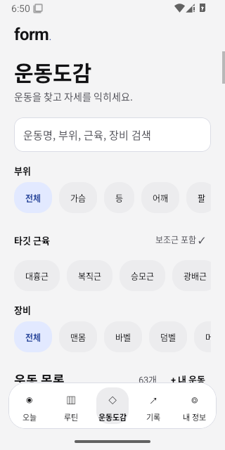
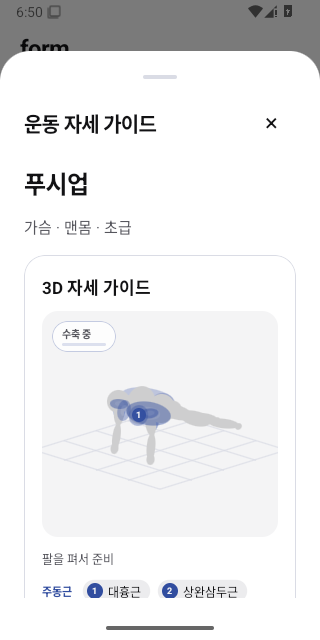
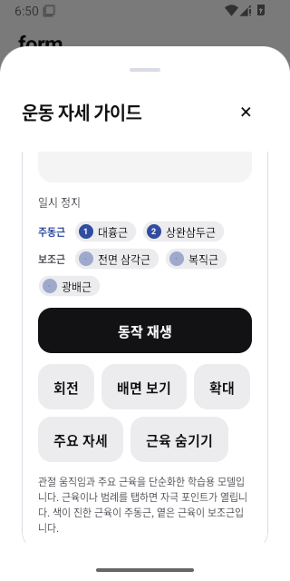
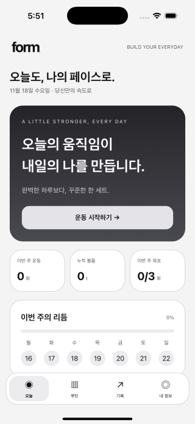
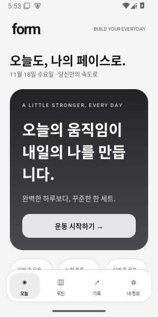

# Form — 운동 기록

미니멀한 iOS·Android 운동 기록 앱. React Native의 네이티브 뷰, Swift HealthKit 모듈, Kotlin Health Connect 모듈, SwiftUI Apple Watch 앱, Compose Wear OS 앱을 포함합니다. WebView나 PWA를 앱으로 포장하지 않습니다.

> **현재 단계: 네이티브 테스트 빌드.** Android에서 운동 저장·재실행 복원과 다크·Glass 설정 유지까지 확인했습니다. iOS는 시뮬레이터 홈 실행과 재실행을 확인했습니다. 실기기 건강 권한·워치 페어링·스토어 배포 검증이 남아 있습니다. [검증 기록](docs/VALIDATION.md)

## 11월 19일 업데이트

WWIT의 Planfit 화면에서 운동을 고르고 세트를 입력하는 흐름을 참고했습니다. 홈, 루틴·세트 기록, 운동도감·자세 안내, 기록·인바디, 설정의 타이포그래피와 조작 요소를 정리했습니다. [UI 변경 내역](docs/WWIT-UI-UPDATE.md) · [로컬 검증](docs/evidence/2026-11-19-local-tests.txt)

iOS를 Android와 같은 기능으로 맞춘 감사·변경 기록: [iOS 동기화 기록](docs/IOS-PARITY-2026-11-19.md)

## 버전별 변경사항

| 버전 | 배포·변경 내용 |
|---|---|
| 0.2.0 | 앱 표시 이름 **Form**, Android·iOS 빌드 번호 2. 근육 기능을 포함하며 일시정지→계속하기→저장 종료를 검증 경로에 추가했습니다. |
| 0.1.0 피드백 프리뷰 | 3D 자세 22종, 근육 해부 그래픽과 터치, 주간 근육 볼륨, 운동도감 근육 필터. [Android 프리뷰](https://github.com/M0lli2/form-fitness/releases/tag/preview-2026-11-19-feedback) |
| 0.1.0 초기 프리뷰 | 운동 기록, 3D 자세 8종, 라이트·다크와 Liquid Glass. [초기 프리뷰](https://github.com/M0lli2/form-fitness/releases/tag/preview-2026-11-19) |

## 기능 사용법

| 기능 | 사용 방법 |
|---|---|
| 운동 시작·일시정지·종료 | 루틴 또는 운동도감에서 시작합니다. 일시정지하면 운동 시간과 휴식 타이머가 멈춥니다. 계속하기로 기록을 이어가고 운동 종료에서 완료한 세트를 저장합니다. |
| 3D 자세·근육 정보 | 운동도감에서 3D 표시가 있는 운동을 열어 재생하거나 8방향으로 회전합니다. 모델의 근육 또는 범례를 누르면 자극 포인트와 자세 팁이 열립니다. |
| 주간 근육 볼륨 | 기록 화면의 **이번 주 근육 볼륨**에서 최근 7일간 완료한 세트가 어느 근육에 분포했는지 앞면·배면으로 봅니다. |
| 근육별 운동 검색 | 운동도감의 **타깃 근육**에서 세부 근육을 선택합니다. 보조근 포함 스위치와 장비 필터를 함께 사용할 수 있습니다. |
| 인바디·건강·워치 | 기록에서 체성분과 결과지 사진을 저장합니다. 내 정보에서 건강 앱 연결과 워치 연결 상태를 확인합니다. |

### 피드백 반영판 실제 화면

아래 화면은 피드백 기능이 처음 적용된 0.1.0 Android 에뮬레이터에서 캡처했습니다. [실행 기록과 원본 이미지](https://github.com/M0lli2/form-fitness/actions/runs/44474655697)

| 운동도감 근육 필터 | 3D 근육 해부 | 근육 범례와 회전 조작 |
|---|---|---|
|  |  |  |

## 설치

- **Android·Wear OS** — [0.1.0 초기 프리뷰 다운로드](https://github.com/M0lli2/form-fitness/releases/tag/preview-2026-11-19). 휴대폰 APK에 이번 UI와 3D 가이드를 포함했습니다. Wear OS APK는 동일 서명의 기존 동반 앱입니다. [APK 검증 기록](docs/evidence/2026-11-19-android-apk.txt)
- **iPhone·Apple Watch** — [TestFlight·등록 기기 설치 방법](docs/INSTALL.md#iphone--apple-watch-설치)
- [설치 순서와 남은 실기기 검증](docs/INSTALL.md)

## 이전 테스트 빌드 실행 화면

GitHub Actions의 Android 에뮬레이터와 iPhone 시뮬레이터에서 캡처한 화면입니다. 운동 히스토리에는 자동 테스트가 저장한 푸시업 기록이 표시됩니다.

| iPhone 홈 | Android 홈 | 운동 중 휴식 및 세트 완료 |
| :---: | :---: | :---: |
|  |  |  |

| 다크 모드 · Glass 켜짐 | 재실행 후 운동 기록 |
| :---: | :---: |
|  |  |

Android 캡처는 [저장·복원 테스트](https://github.com/M0lli2/form-fitness/actions/runs/44246921105), iPhone 홈 캡처는 [iOS 실행 검증](https://github.com/M0lli2/form-fitness/actions/runs/44245272504)에서 확인할 수 있습니다.

## 이번 통합 변경

- Planfit 공개 화면을 참고한 한 운동 집중 기록 화면을 실제 앱에 연결했습니다.
- 무채색 테마와 시스템 글꼴, 내용 영역의 불투명 패널, 조작·탐색 영역의 선택형 유리 효과를 적용했습니다.
- 세트 입력과 완료를 함께 저장하며 워치 독립 운동 백업 복원을 수정했습니다.
- 99% 기능·화면 동등성은 검증되지 않았습니다. 현재 기본 63종 운동 안내, 사용자 운동 등록, 수동 인바디 입력을 제공합니다.

## 운동도감과 3D 자세

- 하단 **운동도감**에서 운동을 선택하면 자세 상세가 열립니다. 운동 중 **운동 추가**에서도 자세를 확인한 뒤 추가할 수 있습니다.
- 3D 가이드는 푸시업, 맨몸 스쿼트, 글루트 브리지, 카프 레이즈, 덤벨 컬, 레터럴 레이즈, 고블릿 스쿼트, 바벨 오버헤드 프레스에 제공됩니다.
- 모델은 관절 좌표 기반입니다. 재생·일시 정지, 방향 전환, 확대, 주요 자세 전환을 지원합니다. 다른 운동도 단계별 텍스트 가이드를 제공합니다.
- **근육 해부 그래픽**을 함께 표시합니다. 인체 실루엣 위에 주동근은 강조색으로, 보조근은 옅게 칠하고 근육 위 번호와 범례를 연결합니다. 8방향 입체 투영은 네이티브 View로만 그려 오프라인에서 동작하며, '근육 숨기기'로 기존 관절 가이드로 돌아갑니다. [상세](docs/MOTION-GUIDE.md)
- 이전 테스트 빌드 실행 화면의 이미지는 이번 변경 이전에 검증한 빌드에서 캡처했습니다. 새 화면의 네이티브 캡처는 재빌드 후 갱신합니다.

## 디자인 검토

- 라이트 / 다크 / 시스템 설정 추종.
- **Liquid Glass ON/OFF 독립 설정**. 기본 OFF.
- OFF: 단색 패널. ON: 지원 iOS에서 네이티브 GlassView, 다른 환경에서 반투명 패널.
- 투명도 줄이기, 44~48pt 이상 주요 터치 영역, 명시적인 저장 오류, 빈 상태.
- 최신 요청: **무채색 중심 + 선명한 유리 효과 + 읽기 쉬운 타이포그래피**. 디자인 최종 승인 대기.
- `design/preview.html`: 홈·운동·인바디 비교용 인터랙티브 시안. 네이티브 앱 실행 화면이 아니며 샘플 수치를 사용합니다.
- `design/review-01.png`: 첫 번째 시안. 최신 수정 요청 전 버전으로 이력을 보존합니다.

## 구현한 소스 범위

| 영역 | 포함 내용 | 한계 / 후속 작업 |
|---|---|---|
| 운동 기록 | 세트, 중량, 횟수, 시간, 거리, 일반·워밍업·드롭, 메모, 이전 기록 채움 | 고급 슈퍼세트·RPE 전용 입력 개선 필요 |
| 휴식 | 종료 시각 기준 타이머, 로컬 알림, 취소 | OS 강제 종료·절전 모드 실기기 확인 필요 |
| 루틴 | 생성·편집·운동 선택, 기본 전신·상체·하체·맨몸 루틴 | 주간 캘린더 예약 미구현 |
| 성장 | 히스토리, 주간 볼륨, 추정 1RM | 소셜 기능 미구현 |
| 운동법 | 한국어 기본 63종, 사용자 운동 등록, 부위·장비 검색, 3단계 설명, 주의사항 | 모든 운동을 망라하지 않음. 3D 관절 가이드 22종. 나머지 3D·동작 영상·트레이너 감수는 후속 |
| 인바디 | 측정일, 체중, 체지방률, 골격근량, 키, 허리둘레, 내장지방 레벨, BMR, 메모, 사진 | 수동 입력. 제조사 API / OCR 미구현 |
| Apple 건강 | 걸음·심박·체중·체지방·최근 운동 읽기, 체중·체지방·운동 쓰기 | 실기기 검증 전. 피트니스 링 반영은 Apple 정책에 따름 |
| Android 건강 | Health Connect 읽기·쓰기, 권한 안내 Activity | Samsung Health에서 공유 설정한 호환 데이터만 사용 |
| Apple Watch | 세트 완료 리모컨, 독립 운동, 심박·에너지, HealthKit 저장 | iPhone 앱에 포함되는 것을 CI에서 확인. 배포 서명·실기기 페어링 검증 필요 |
| Galaxy Watch | Wear OS 세트 리모컨, 독립 타이머·심박, 휴대폰 전송 | Watch4 이후 Wear OS 대상. Tizen 미지원. 심박 시계열 저장 미구현 |
| 데이터 | SQLCipher DB, 기기 보안 저장소 키, 백업 병합/내보내기 | 로그인·서버·기기 간 클라우드 동기화 미구현 |

## 구조

```text
src/                     네이티브 화면, 테마, 도메인 로직, 암호화 DB
modules/form-device/     Swift / Kotlin 네이티브 연동 모듈
watchos/                 SwiftUI Apple Watch 앱과 XcodeGen 설정
wearos/                  Kotlin Compose Wear OS 독립 빌드 프로젝트
plugins/                 Expo prebuild 구성
tests/                   데이터 검증·중복 이벤트·계산 테스트
design/                  승인용 UI 시안 (프로덕션 앱과 별도)
docs/                    아키텍처, 설정, 검증, 출시 과제
.github/workflows/       소스 검사 및 수동 네이티브 빌드
```

## 휴대폰 앱 실행

Node.js 22 LTS 이상, npm, JDK 17, Android Studio/SDK 36이 필요합니다. iOS는 macOS와 Xcode가 필요합니다. **Expo Go로는 커스텀 네이티브 모듈·SQLCipher를 실행할 수 없습니다.**

```sh
git clone https://github.com/M0lli2/form-fitness.git
cd form-fitness
npm install
npx expo install --check
npm test
npm run check
npm run typecheck
npx expo prebuild --platform android
npm run android
# macOS:
npm run ios:prepare
npm run ios
```

SDK 54와 CI에서 검증한 `package-lock.json`으로 의존성을 고정했습니다. 재현 설치에는 `npm ci`를 사용합니다. `expo install --check`에 불일치가 나오면 해당 SDK가 권장하는 버전으로 맞춘 뒤 테스트하세요. 네이티브 모듈 수정 후에는 앱을 다시 빌드해야 합니다.

### 개발 빌드 / 배포 빌드

```sh
npx eas-cli build --profile development --platform android
npx eas-cli build --profile preview --platform android
npx eas-cli build --profile production --platform ios
```

EAS 계정·프로젝트 연결·개발자 서명은 저장소에 포함하지 않습니다. 사용자 계정에서 설정해야 합니다. 스토어 제출은 자동 실행하지 않습니다.

## Apple Watch

1. macOS에서 `brew install xcodegen`.
2. `cd watchos && xcodegen generate`.
3. `FORMWatch.xcodeproj`를 Xcode로 열고 개발자 Team을 선택합니다.
4. 휴대폰 앱과 워치 앱에 HealthKit capability를 활성화합니다.
5. 휴대폰: `com.mori.form`, 워치: `com.mori.form.watchkitapp`, companion: `com.mori.form`을 일치시킵니다.
6. `npm run ios:prepare`로 휴대폰 프로젝트에 워치 타깃과 Embed Watch Content를 추가합니다. EAS iOS 빌드는 post-install hook에서 같은 절차를 실행합니다. CI에서 iPhone 앱 내부 `Watch/FORMWatch.app` 존재까지 확인했습니다. 서명된 EAS 배포는 개발자 계정에서 별도 검증해야 합니다.
7. 페어링된 실제 iPhone/Apple Watch에 설치해 권한·심박·전송을 검증합니다.

Apple Watch가 HealthKit에 저장한 운동은 휴대폰에서 다시 내보내지 않습니다. 운동 중 프로세스 종료 복구와 저장 실패 재시도는 출시 전 보강 항목입니다.

## Galaxy Watch / Wear OS

JDK 17, Gradle 8.11.1, Android SDK 36이 필요합니다. Android Studio에서 `wearos/`를 열거나 다음을 실행합니다.

```sh
gradle -p wearos wrapper --gradle-version 8.11.1
cd wearos
./gradlew assembleDebug
```

휴대폰과 워치의 applicationId 및 서명 인증서가 같아야 Data Layer 통신이 가능합니다. 서로 다른 머신의 기본 debug 키를 섞지 마세요. Play 배포 시 같은 앱의 Wear OS 트랙을 사용합니다. Galaxy Watch4 이상 Wear OS 기기를 대상으로 하며 구형 Tizen Galaxy Watch는 별도 앱이 필요합니다.

## 건강 연동과 데이터 의미

- iOS: HealthKit → Apple 건강. 건강에 저장된 운동이 피트니스에 어떻게 표시되는지는 Apple이 결정합니다. 모든 피트니스 점수·링을 직접 수정할 수 없습니다.
- Android: Health Connect ↔ 호환 앱. Samsung Health의 Health Connect 공유 설정이 필요합니다. Samsung 계정·모든 Samsung 독점 지표를 직접 읽는 구현은 아닙니다.
- **골격근량 ≠ 제지방량.** 골격근량을 HealthKit lean body mass로 잘못 저장하지 않습니다.
- 체지방률: 앱과 Health Connect에서는 0~100, HealthKit에서는 0~1로 변환합니다.
- 건강 권한은 사용자가 연결 버튼을 누를 때 요청합니다. 읽기 허용 여부를 iOS에서 확정적으로 알 수 없으므로 성공을 과장하지 않습니다.
- 읽은 값이 없는 경우 0이나 가짜 데이터를 채우지 않습니다.
- 샘플 쓰기에 안정적인 ID를 사용해 재전송 중복을 억제합니다. 편집한 데이터의 버전 정책은 출시 전 추가 검증합니다.

## 데이터 보관

- 운동·체성분은 SQLCipher DB에 저장, 키는 SecureStore에 보관합니다.
- 인바디 사진은 앱 전용 폴더에 저장됩니다. 별도 사진 암호화는 아직 없습니다.
- 백업 JSON은 **평문**이며 사진을 포함하지 않습니다. 공유 전 안내가 표시됩니다.
- 앱 기록 삭제와 HealthKit / Health Connect에 이미 내보낸 기록 삭제는 별개입니다.
- 분석·광고·원격 서버 전송 코드는 없습니다.
- `docs/PRIVACY.md`는 구현 설명 초안이며 실제 스토어 제출 시 사업자 정보와 공개 정책 URL을 보완해야 합니다.

## 코드 주석 기준

각 코드 파일에 역할을 설명하고 저장 순서, 권한 처리, 단위 변환, 중복 제거, 플랫폼 차이 등 오해하기 쉬운 로직에 주석을 작성했습니다. JSON은 주석을 지원하지 않으므로 이 README와 문서에 구성 의미를 설명합니다.

## 검증

```sh
npm test                   # 의존성 없이 도메인 테스트
npm run check              # JSON·브리지 계약·앱 ID 검사
npm run typecheck          # npm install 필요
```

GitHub Actions의 `Source checks`는 push 시 실행합니다. `Native build validation`은 Actions에서 수동 실행합니다. **실행 설정이 존재한다는 사실은 빌드 성공을 의미하지 않습니다.**

## 다음 출시 게이트

1. 의존성 설치·타입 검사·Android/iOS/Wear/watchOS 컴파일 통과.
2. 무채색·선명한 Glass·폰트 수정 시안 승인 및 네이티브 화면 일치.
3. 실제 4종 기기에서 권한 거부/부분 허용/취소/오프라인/재연결/강제종료 검사.
4. 건강 데이터 원본 구분, 수정·삭제 동기화, 보안·접근성 검토.
5. 운동 콘텐츠 전문가 감수, 자체 동작 이미지/영상 확보.
6. App Store / Play Console 건강 권한·개인정보·심사 정보 작성 및 서명 배포.

상위 앱의 모든 기능과 모든 운동을 완료했다고 주장하지 않습니다. 목표와 실제 구현·검증 상태를 구분하여 유지합니다.

## 후속 구현·검증 기록 (2026-11-18)

- 집중 기록 화면 kg/lb 변환 일관성과 인바디 수정 버전 처리를 보강했습니다. 건강 재전송은 저장된 revision을 유지하며 로컬 편집 저장 때만 올립니다.
- 기본 목록에 없는 운동은 사용자 운동으로 등록해 루틴·세트 기록·백업에서 사용합니다.
- 로컬 회귀 테스트 26개 통과. e210fcc 전체 타입 검사와 Android JS 번들 성공.
- 8deb2e6 Android Release 홈·4개 메뉴·재실행 검증 성공. Apple Watch embed는 1462eee / 0672495 Apple job 성공.
- npm audit 호환 업데이트 실험에서는 React Native Flow 구문 번들이 실패하여 해당 자동 수정 lock을 채택하지 않았습니다. 배포 전 의존성 보안 업데이트 검증이 남아 있습니다.
