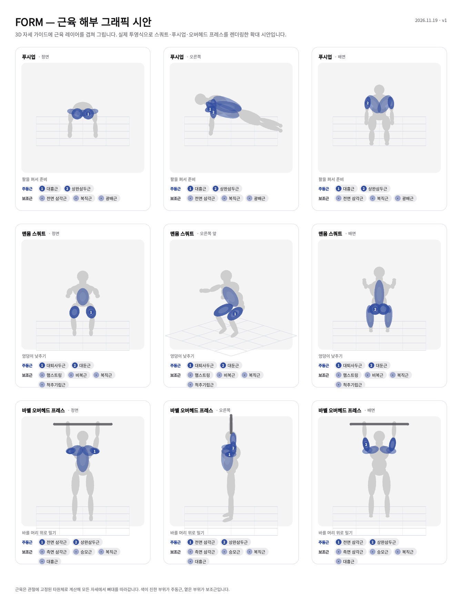

# 운동도감 화면 검토

| 화면 | 변경 |
|---|---|
| 오늘 | 큰 홍보 문구 대신 운동 시작과 이어하기를 먼저 표시합니다. |
| 운동도감 | 하단에서 바로 열고, 이름·부위·장비로 검색합니다. 목록에서 3D 제공 여부를 확인할 수 있습니다. |
| 운동 자세 | 재생·정지, 8방향 회전, 확대, 시작·끝 자세, 근육 해부 그래픽 표시를 제공합니다. 자세 설명과 주의사항은 아래에 유지합니다. |
| 운동 추가 | 항목을 누르면 자세 상세를 먼저 열고, 별도 버튼으로 추가합니다. |
| 타이포그래피 | 한국어 시스템 글꼴을 유지하고 제목·본문·탭의 크기와 줄간격을 조정했습니다. 라이트·다크와 선택형 Glass를 적용합니다. |

3D는 학습용 모델입니다. 22종에 동작 좌표를 제작했으며 운동별 영상과 자동 자세 채점은 포함되지 않습니다. 3D 이외 운동은 기존 설명을 유지합니다.

## 근육 해부 그래픽 (2026-11-19)

같은 투영 모듈로 렌더링한 시안입니다(푸시업·맨몸 스쿼트·오버헤드 프레스 × 정면·측면·배면).

- 스테이지에 인체 실루엣(머리·목·가슴·어깨·허리·골반·팔·다리 12부위)과 근육 레이어를 함께 투영합니다. WebView 없이 네이티브 View만 사용하므로 오프라인에서도 동작합니다.
- 근육 16부위를 관절에 고정된 타원체 하나로 정의했습니다. 회전하면 깊이순으로 정렬되고, 몸 뒤쪽을 향한 근육은 실루엣에 가려 보이지 않습니다(돌리면 나타남).
- **주동근**은 테마 강조색으로 진하게, **보조근**은 같은 색을 옅게 칠합니다. 주동근에는 모델 위에 번호를 찍고 아래 범례의 같은 번호와 연결합니다.
- 버튼: 회전 · 배면 보기(앞면 보기) · 확대 · 주요 자세 · 근육 숨기기. 근육을 숨기면 기존 관절 스켈레톤 화면으로 돌아갑니다.
- 8방향 어디서 봐도 화면에 들어오도록 운동별 공통 배율을 계산해 회전 중 크기가 바뀌지 않습니다.
- 운동별 매핑: 스쿼트·고블릿=대퇴사두근·대둔근 / 햄스트링·비복근·복직근·척추기립근, 푸시업=대흉근·상완삼두근 / 전면 삼각근·복직근·광배근, 브리지=대둔근·햄스트링 / 척추기립근·복직근·비복근, 카프=비복근·가자미근 / 햄스트링·대퇴사두근, 컬=상완이두근 / 전완근·전면 삼각근, 레터럴=측면 삼각근 / 승모근·전면 삼각근, 오버헤드 프레스=전면 삼각근·상완삼두근 / 측면 삼각근·승모근·복직근·대흉근.
