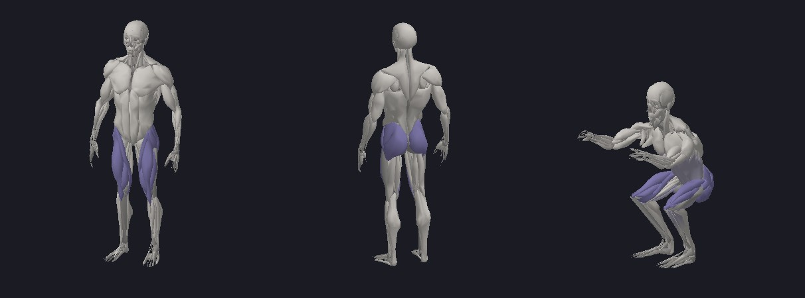

# 운동도감의 3D 근육 모델

운동도감의 기본 운동 63종에서 3D 근육 모델을 열 수 있습니다. 자세 좌표가 있는 22종은 반복 재생, 일시정지, 8방향 회전, 확대와 시작·끝 자세를 지원합니다. 나머지 종목과 사용자 추가 운동은 앞면·배면 근육 모델과 기존의 단계별 운동 방법을 표시합니다.

도감의 타깃 근육 선택, 운동 상세, 기록의 최근 7일 근육 볼륨은 같은 모델을 사용합니다. 회백색을 기본으로 쓰며 운동의 주동근·보조근, 직접 고른 근육, 기록된 볼륨은 보라색으로 표시합니다. 운동 상세에서 근육을 누르면 부위 이름을 확인할 수 있습니다. 동작을 재생하는 동안 근육 표면은 약 0.3초 간격으로 자세에 맞춰 갱신되고, 관절과 장비 선은 매 프레임 부드럽게 움직입니다.

## 입체 근육 모델

이 그림은 Form의 동일한 모델·포즈·음영 코드를 사용한 오프라인 렌더입니다. 모델에 관절 가중치를 매겨 기존 자세 좌표에 맞추고, iOS·Android 네이티브 캔버스에서 깊이 비교로 가려진 면을 처리합니다. 동작은 학습용 예시입니다.

원본은 Diego Luján García의 [Male Full Body Ecorche](https://sketchfab.com/3d-models/male-full-body-ecorche-ab11ebff89224f03bd75efede1164cf6)이며 [CC BY 4.0](https://creativecommons.org/licenses/by/4.0/)으로 제공됩니다. Form은 원본의 16개 표면을 모바일용 약 1만 개 삼각형으로 정리하고 자세 가중치, 근육 분류, 색상과 음영을 추가했습니다. [소스 및 변환 방법](anatomy-sculpt-source.md)
