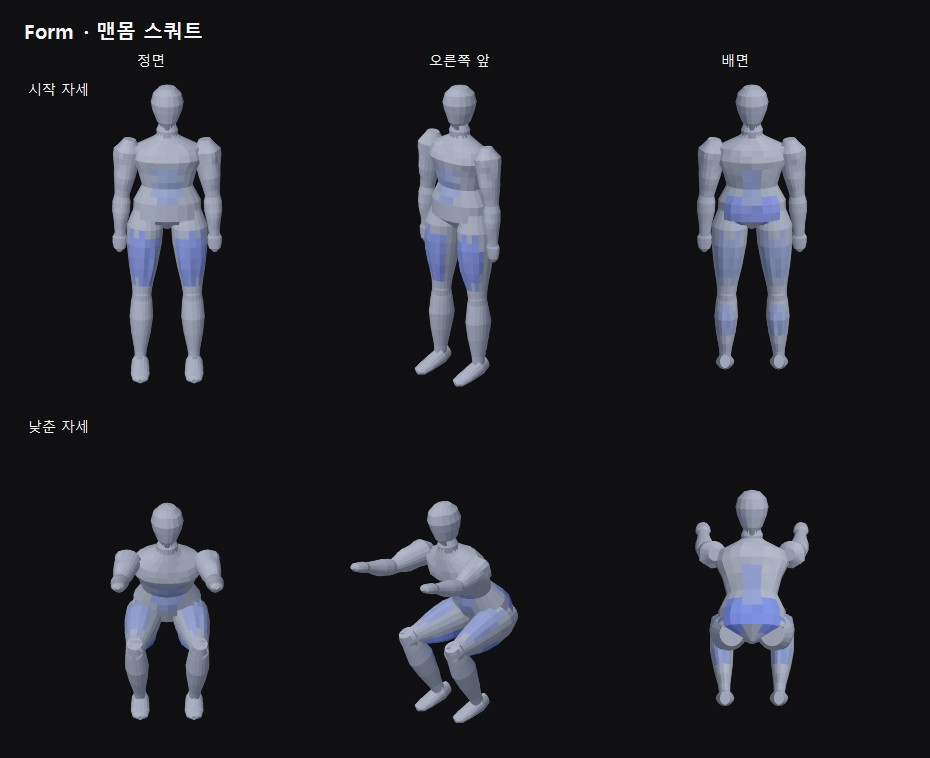

# 운동도감 화면 검토

| 화면 | 변경 |
|---|---|
| 오늘 | 큰 홍보 문구 대신 운동 시작과 이어하기를 먼저 표시합니다. |
| 운동도감 | 하단에서 바로 열고, 이름·부위·장비로 검색합니다. 목록에서 3D 제공 여부를 확인할 수 있습니다. |
| 운동 자세 | 재생·정지, 8방향 회전, 확대, 시작·끝 자세, 근육 해부 그래픽 표시를 제공합니다. 자세 설명과 주의사항은 아래에 유지합니다. |
| 운동 추가 | 항목을 누르면 자세 상세를 먼저 열고, 별도 버튼으로 추가합니다. |
| 타이포그래피 | 한국어 시스템 글꼴을 유지하고 제목·본문·탭의 크기와 줄간격을 조정했습니다. 라이트·다크와 선택형 Glass를 적용합니다. |

3D는 학습용 모델입니다. 22종에 동작 좌표를 제작했으며 운동별 영상과 자동 자세 채점은 포함되지 않습니다. 3D 이외 운동은 기존 설명을 유지합니다.

## 입체 근육 모델

0.3.2부터 근육 표면에 조형을 더하고 각 정점의 조명을 이어 그립니다. 팔꿈치와 무릎은 연결된 표면으로 움직이고, 깊이 버퍼가 겹친 면의 표시 순서를 결정합니다.

이 그림은 상세 조형을 적용하기 전의 초기 모델 검토 이미지입니다.

- 관절을 따라 몸통과 팔다리 단면을 연결하고 16개 근육 부위를 별도 표면으로 표시합니다.
- 뒤에서 앞으로 면을 그리며, 몸에 가린 근육은 탭할 수 없습니다. 회전하면 반대편 근육이 나타납니다.
- 22개 기존 3D 자세는 주동근과 보조근을 색으로 구분합니다. 운동도감의 근육 필터와 기록의 최근 7일 근육 볼륨에도 같은 입체 표면을 사용합니다.
- iOS·Android의 네이티브 캔버스에서 그리는 학습용 모델입니다.
